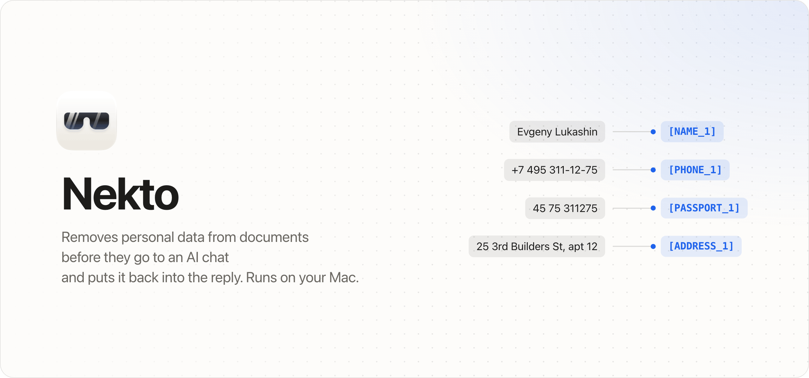
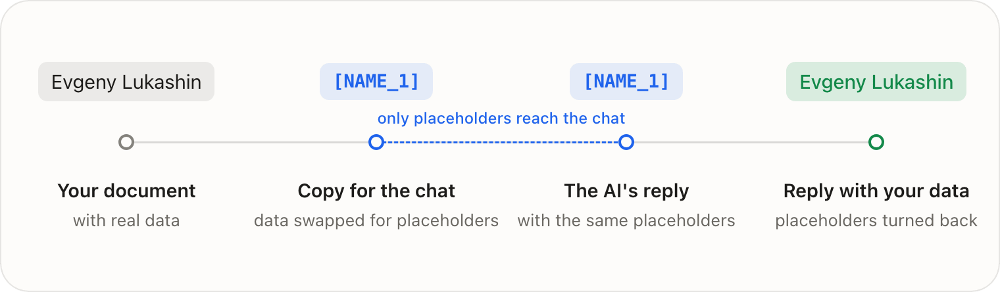
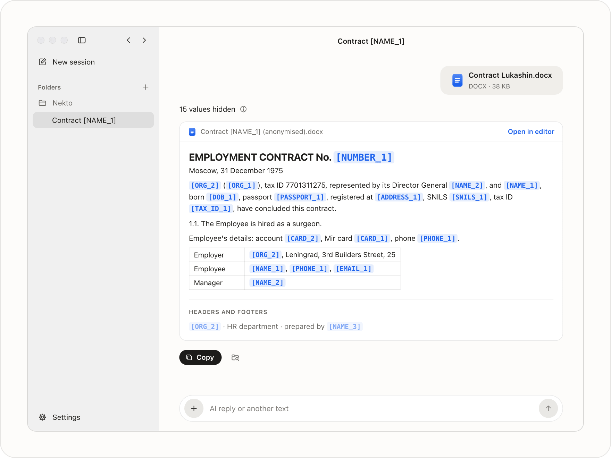
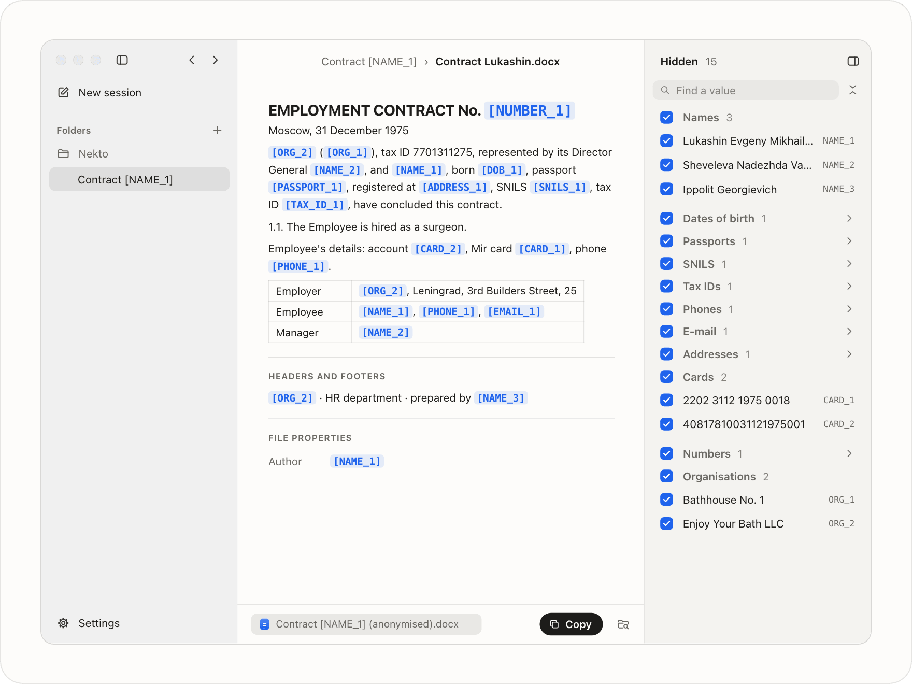
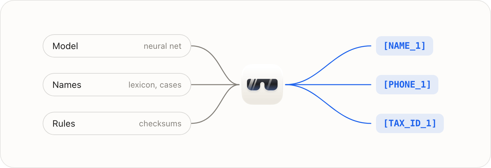
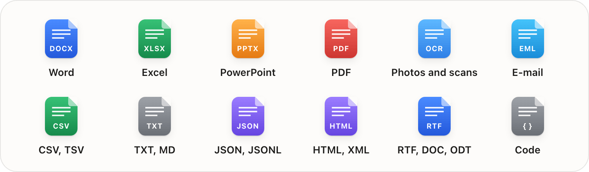
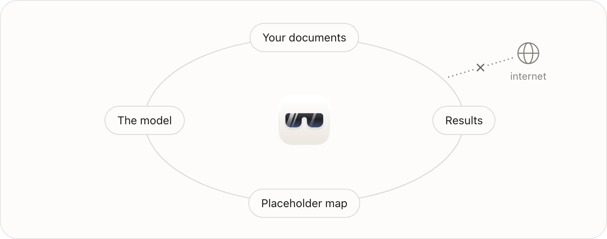

<p align="center">
  <picture>
    <source media="(prefers-color-scheme: dark)" srcset="docs/assets/readme/cover-en-dark.png">
    
  </picture>
</p>

<p align="center">
  <a href="README.md">Русский</a> · <b>English</b>
</p>

<p align="center">
  
  
  
  
  <a href="LICENSE"></a>
</p>

Nekto lets you work with AI chats (ChatGPT, Claude and others) on documents that contain other people's personal
data. Before you send a document, the app finds names, phone numbers, passport details, addresses and similar
information about people and replaces them with placeholders such as `[NAME_1]` or `[PHONE_1]`. The AI gets a text
that identifies no one but still makes sense. When it replies, you paste the reply into Nekto, and the app puts the
real data back in place of the placeholders.

Nekto runs only on your Mac. Documents are not uploaded anywhere: the part of the app that looks for personal data
runs on your computer and has no internet access.

Nekto is made for documents in Russian. It knows Russian names and how they change with grammatical case, and it
checks Russian ID numbers. The app itself is in Russian as well, including its placeholders and file names. On this
page the pictures, placeholders and file names are translated into English.

## How it works

<p align="center">
  <picture>
    <source media="(prefers-color-scheme: dark)" srcset="docs/assets/readme/flow-en-dark.png">
    
  </picture>
</p>

Say you want an AI to review an employment contract. You drop the file onto the Nekto window, and the app makes a
copy where the employee's name, passport number, address and phone are replaced with placeholders. You send that
copy to the chat. The AI replies using the same placeholders. You paste the reply into Nekto and get the same text
back with the real names and numbers in it.

Each person gets one placeholder however the text refers to them. In Russian a name changes form with grammatical
case, so "Lukashin Evgeny Mikhailovich", "Lukashina" and "E. M. Lukashin" all become the same `[NAME_1]`, and the
AI can tell they are the same person. Nekto groups the documents and replies you work on together into one session,
much like a chat thread, and the placeholders are shared by every file in it.

## What the app looks like

<p align="center">
  <picture>
    <source media="(prefers-color-scheme: dark)" srcset="docs/assets/readme/screen-feed-en-dark.png">
    
  </picture>
</p>

A processed document shows up in the window right away and looks like the original. Tables, headers and footers,
and slides stay where they were, and placeholders are highlighted in blue. The *Copy* button copies text you can
paste into a chat. The results folder also holds an anonymised file in the original format, which you can attach to
a message as is. Hold <kbd>⌥</kbd> to see the original values in place of the placeholders and check them.

<p align="center">
  <picture>
    <source media="(prefers-color-scheme: dark)" srcset="docs/assets/readme/screen-editor-en-dark.png">
    
  </picture>
</p>

The search sometimes gets things wrong. It can miss a value or take an ordinary word for a surname. That is why
everything it found is listed on the right, in the *Hidden* panel, grouped by type. A checked box means the value is
hidden. If Nekto got it wrong, uncheck the box; to hide something it missed, select it in the text and hide it from
the context menu, and it joins the panel with a checkbox of its own. The change applies at once to every document
in the session, and <kbd>⌘Z</kbd> undoes a checkbox click. The same panel lets you keep dates or links in the text
and turn on hiding of company names. The app remembers these settings.

## What Nekto finds

<p align="center">
  <picture>
    <source media="(prefers-color-scheme: dark)" srcset="docs/assets/readme/engine-en-dark.png">
    
  </picture>
</p>

Nekto looks for personal data in three ways at once and compares the results. A language model flags words that look
like names, addresses or numbers. A lexicon of Russian first names and surnames, with all their case forms, checks
whether a flagged word really is a person. Rules recognise numbers by their format and verify check digits: in a tax
ID, an insurance number or a bank card, the last digits are computed from the others, so a random number does not
pass as one.

| Placeholder | What it hides |
|---|---|
| `[NAME_n]` | first names, surnames, patronymics and initials in any case form, including Latin spelling |
| `[DOB_n]`, `[DATE_n]` | dates of birth (these cannot be kept) and other dates (you can keep these) |
| `[PASSPORT_n]`, `[SNILS_n]`, `[TAX_ID_n]` | passport numbers, insurance numbers (SNILS) and tax IDs (INN) |
| `[CARD_n]`, `[ACCOUNT_n]` | bank card and account numbers |
| `[PHONE_n]`, `[EMAIL_n]`, `[ADDRESS_n]` | phone numbers, e-mail and street addresses |
| `[LINK_n]`, `[USERNAME_n]`, `[IP_n]`, `[MAC_n]` | links, user names and network addresses |
| `[SECRET_n]`, `[NUMBER_n]` | passwords, access keys, document and policy numbers |
| `[ORG_n]` | company names, if you turned on hiding them |
| `[PII_n]` | anything you hid yourself from the context menu (*Hide as name* gives the value `[NAME_n]` instead) |

The search finds almost everything, but not everything. It was tested on documents that were not used to tune it.
On the first run, Nekto found 94.1% of the personal data (761 values out of 809) and touched 28 of the 570 passages
it should have left alone. So it is worth looking over the result before you send it. A spreadsheet with 20,000
rows takes about 13 seconds.

## Supported files

<p align="center">
  <picture>
    <source media="(prefers-color-scheme: dark)" srcset="docs/assets/readme/formats-en-dark.png">
    
  </picture>
</p>

Nekto opens Word, Excel and PowerPoint documents, CSV and TSV tables, JSON, HTML and XML files, `.eml` e-mails,
plain text, Markdown and source code itself and saves an anonymised copy in the same format. From a PDF the app
takes the text layer, and pages without one, scans and photos are recognised on your Mac. RTF, DOC and ODT files are
opened by macOS. PDFs, scans, photos and RTF, DOC and ODT files give you anonymised text rather than a copy in the
original format. Legacy XLS and PPT files, as well as Pages, Numbers and Keynote, need to be saved as DOCX, XLSX,
PPTX or PDF first.

## What stays on your Mac

<p align="center">
  <picture>
    <source media="(prefers-color-scheme: dark)" srcset="docs/assets/readme/privacy-en-dark.png">
    
  </picture>
</p>

Your documents, the results, the placeholder map and the model itself are stored on your computer and are not sent
anywhere.

- The part of the app that searches for personal data runs in a macOS sandbox that forbids network access (profile
  [`engine-sandbox.sb`](App/Resources/engine-sandbox.sb)). Its tests run in the same sandbox.
- The map that turns placeholders back into data sits in a hidden `.nekto` folder inside your work folder. It never
  ends up in the anonymised files, and their names are built from already anonymised text. The AI's reply with the
  real data put back (`… (with data).txt`) is saved to the same results folder, though, so send the `(anonymised)`
  files to a chat rather than the whole folder.
- Internet access is needed during installation, to download Python and the language model `rubert-base-pii-ner`
  in ONNX format ([`lockR/rubert-base-pii-ner-onnx`](https://huggingface.co/lockR/rubert-base-pii-ner-onnx)), and
  again only if an app update changes the model or its dependencies. All versions are pinned, and every file is
  checked against its SHA-256 checksum.

## Installation

You need a Mac with Apple silicon (M1 or later), macOS 15 or later and about 2.4 GB of free space during
installation (the app takes about 1.7 GB afterwards).

Ready-made builds are on the [releases](../../releases) page: a `.dmg` disk image, the same Nekto as a `.zip`
and `SHA256SUMS.txt` to verify them (`shasum -a 256 -c SHA256SUMS.txt` in the download folder).

1. Open the `Nekto-<version>-<build>.dmg` disk image and drag Nekto into the Applications folder.
2. The first launch depends on whether the build is signed:
   - **A signed release** is checked by Apple. macOS asks whether to open an app downloaded from the internet —
     click *Open*.
   - **A build not signed by Apple** (`-unsigned` in the file name) is blocked on first launch. Click *Done*, open
     *System Settings* → *Privacy & Security*, click *Open Anyway*, click *Open Anyway* again in the confirmation
     dialog and enter an administrator password. Or run `xattr -dr com.apple.quarantine /Applications/Nekto.app`
     in Terminal. This is needed only once.
3. Click *Install*. The app downloads Python and the model (about 0.8 GB) and checks that everything works.
4. Choose a folder for results. The default is *Documents › Nekto*.

## Building from source

You need Xcode 26 or later (the project builds with Xcode 27.2), [XcodeGen](https://github.com/yonaskolb/XcodeGen)
and Python 3 for the helper scripts.

```bash
./scripts/fetch-uv.sh          # pinned uv, SHA-256 checked
./scripts/build.sh --dmg       # Release → build/share/app.noindex/Nekto.app and dist/Nekto.dmg (ad-hoc, for yourself)
./scripts/release.sh           # Developer ID + notarisation → dist/Nekto-<version>-<build>.dmg, for distribution
./scripts/publish.sh           # GitHub release: disk image, zip and SHA256SUMS.txt (--notarized for a signed one)

./scripts/dev-runtime.sh       # test runtime: the same Python and lock file the app installs
./scripts/fetch-model.sh       # the model for tests (~0.7 GB, SHA-256), unless the app has installed it already
./scripts/test-engine.sh       # engine tests inside the no-network sandbox
./scripts/checks/document-check.sh   # document view and editor engine, without the app
```

The Xcode project is generated from [`App/project.yml`](App/project.yml), so it is not in the repository. How the
app is built, what other checks exist and how to sign a release is described in
[`docs/ARCHITECTURE.md`](docs/ARCHITECTURE.md) (in Russian).

## Repository layout

| Folder | Contents |
|---|---|
| [`App/`](App) | the SwiftUI app: the document window, the editor, the installer, first-launch scenes |
| [`Engine/`](Engine) | the Python program that finds personal data, assigns placeholders and reads and writes files; its tests |
| [`scripts/`](scripts) | building, releasing, tests and checks |
| [`packaging/`](packaging) | the installer disk image artwork, licenses of bundled components |
| [`docs/`](docs/ARCHITECTURE.md) | how the app works, for developers; the images in this README |

## Credits

- The language model [`redmadrobot-rnd/rubert-base-pii-ner`](https://huggingface.co/redmadrobot-rnd/rubert-base-pii-ner)
  (Apache-2.0 license), in ONNX format from [`lockR/rubert-base-pii-ner-onnx`](https://huggingface.co/lockR/rubert-base-pii-ner-onnx).
- [pymorphy3](https://github.com/no-plagiarism/pymorphy3) inflects names using the [OpenCorpora](https://opencorpora.org)
  dictionary (data under CC BY-SA 3.0, package `pymorphy3-dicts-ru`).
- [ONNX Runtime](https://onnxruntime.ai) runs the model without PyTorch, [Tokenizers](https://github.com/huggingface/tokenizers)
  splits text into tokens, [lxml](https://lxml.de) reads and writes Office files, and [uv](https://github.com/astral-sh/uv)
  installs Python.

## License

Nekto is released under the [Apache License 2.0](LICENSE). Authorship and the third-party components bundled with
the app are listed in [`NOTICE`](NOTICE).
