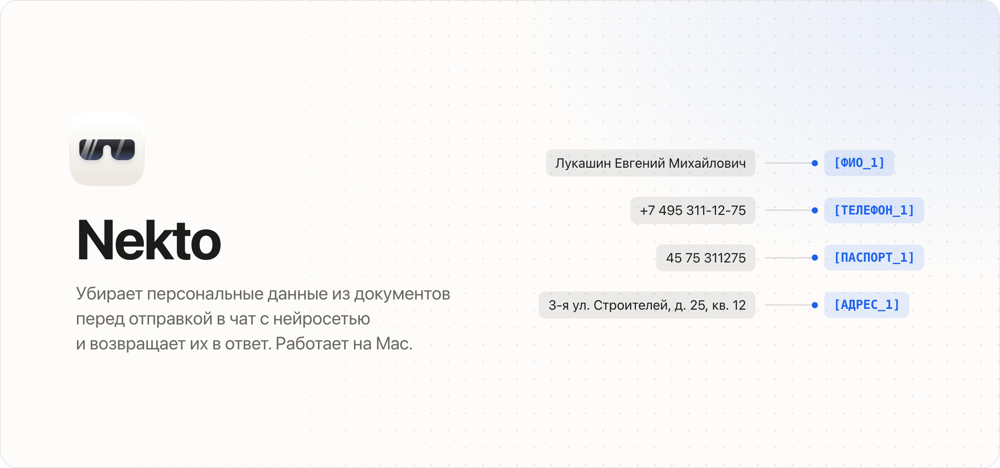
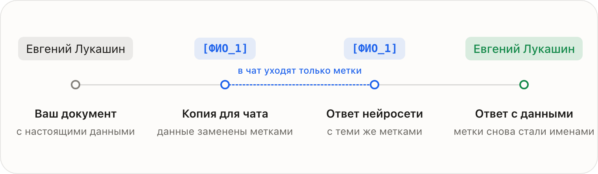
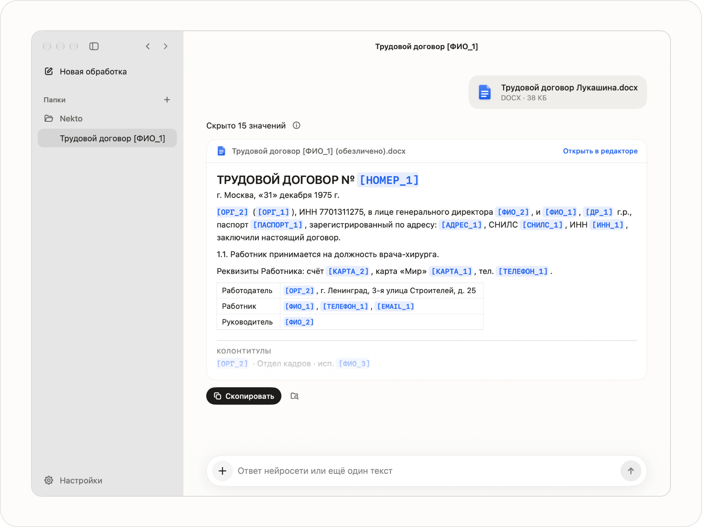
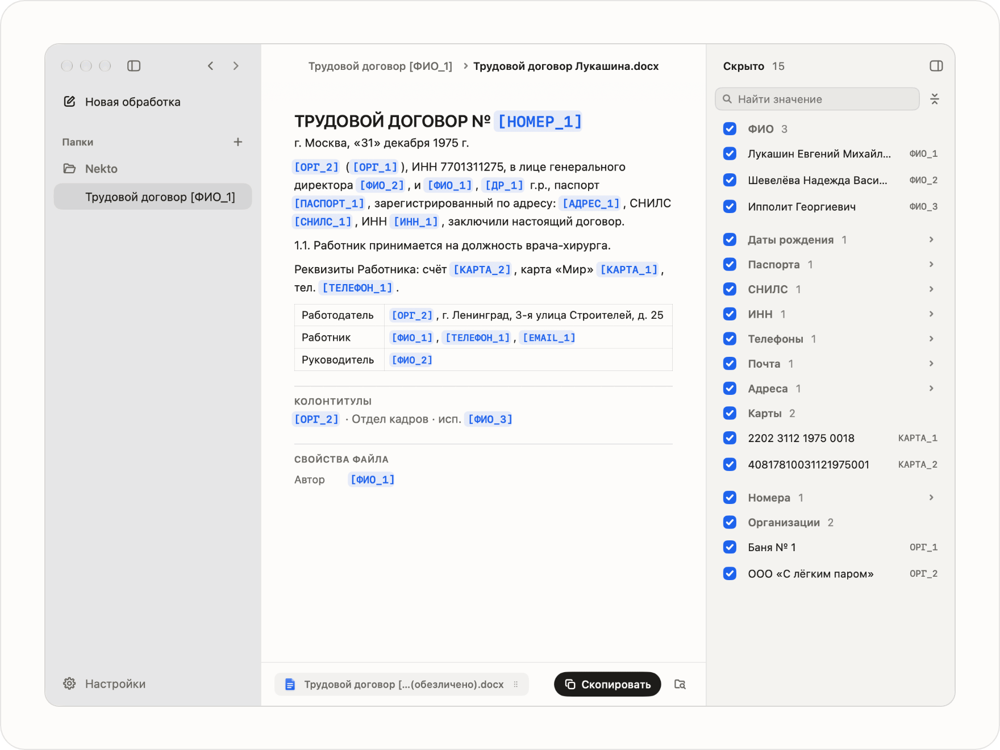
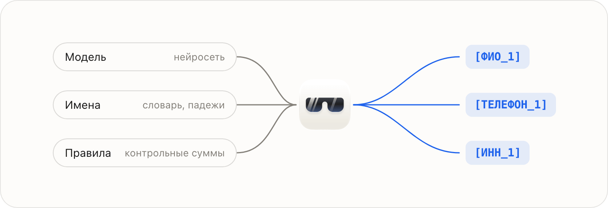
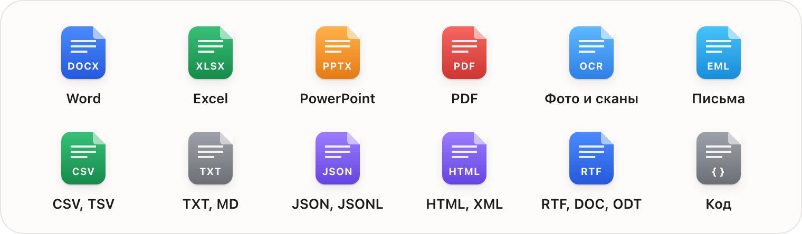
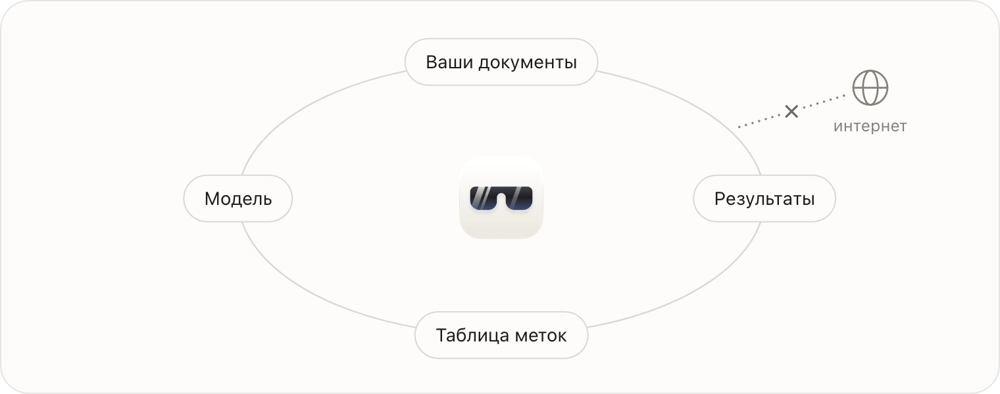

<p align="center">
  <picture>
    <source media="(prefers-color-scheme: dark)" srcset="docs/assets/readme/cover-ru-dark.png">
    
  </picture>
</p>

<p align="center">
  <b>Русский</b> · <a href="README.en.md">English</a>
</p>

<p align="center">
  
  
  
  
  <a href="LICENSE"></a>
</p>

Nekto помогает работать с нейросетями (ChatGPT, Claude и другими) над документами, в которых есть чужие
персональные данные. Перед отправкой приложение находит в документе имена, телефоны, паспортные данные, адреса
и другие сведения о людях и заменяет их метками вроде `[ФИО_1]` или `[ТЕЛЕФОН_1]`. Нейросеть получает текст,
по которому никого нельзя узнать, но смысл документа ей по-прежнему понятен. Когда она ответит, вы вставляете
ответ в Nekto, и приложение подставляет вместо меток настоящие данные.

Nekto работает только на вашем Mac. Документы никуда не отправляются: данные ищет программа на самом компьютере,
и у неё нет доступа к интернету.

## Как это работает

<p align="center">
  <picture>
    <source media="(prefers-color-scheme: dark)" srcset="docs/assets/readme/flow-ru-dark.png">
    
  </picture>
</p>

Допустим, вы хотите, чтобы нейросеть проверила трудовой договор. Вы перетаскиваете файл в окно Nekto, и приложение
делает копию, где имя сотрудника, номер паспорта, адрес и телефон заменены метками. Эту копию вы отправляете в чат.
Нейросеть отвечает и упоминает в ответе те же метки. Вы вставляете её ответ в Nekto и получаете тот же текст,
но уже с настоящими именами и номерами.

Один человек получает одну метку, как бы его ни называли в тексте: «Лукашин Евгений Михайлович», «Лукашина» и
«Е. М. Лукашин» превратятся в один и тот же `[ФИО_1]`. Так нейросеть понимает, где речь об одном и том же человеке.
Документы и ответы, с которыми вы работаете вместе, Nekto объединяет в одну обработку, похожую на переписку в чате,
и метки в ней общие для всех файлов.

## Как выглядит приложение

<p align="center">
  <picture>
    <source media="(prefers-color-scheme: dark)" srcset="docs/assets/readme/screen-feed-ru-dark.png">
    
  </picture>
</p>

Обработанный документ сразу появляется в окне и выглядит как оригинал: таблицы, колонтитулы и слайды остаются
на своих местах, а метки выделены синим. Кнопка «Скопировать» копирует текст, который можно вставить в чат.
В папке с результатами лежит и обезличенный файл того же формата, его можно приложить к сообщению целиком.
Если зажать клавишу <kbd>⌥</kbd>, на месте меток появятся исходные значения, и вы сможете их сверить.

<p align="center">
  <picture>
    <source media="(prefers-color-scheme: dark)" srcset="docs/assets/readme/screen-editor-ru-dark.png">
    
  </picture>
</p>

Поиск иногда ошибается: может пропустить значение или принять за фамилию обычное слово. Поэтому всё найденное
собрано справа, в панели «Скрыто», по группам. Галочка у значения означает, что оно скрыто. Если Nekto ошибся,
снимите галочку, а пропущенное значение выделите в тексте и скройте через контекстное меню: оно появится в той же
панели со своей галочкой. Изменение сразу применяется ко всем документам обработки, а щелчок по галочке
отменяется сочетанием <kbd>⌘Z</kbd>. В той же панели можно оставить в тексте даты или ссылки и включить скрытие
названий организаций. Эти настройки приложение запоминает.

## Какие данные Nekto находит

<p align="center">
  <picture>
    <source media="(prefers-color-scheme: dark)" srcset="docs/assets/readme/engine-ru-dark.png">
    
  </picture>
</p>

Nekto ищет данные тремя способами сразу и сверяет результаты. Языковая модель отмечает слова, похожие на имена,
адреса или номера. Словарь имён и фамилий с падежами проверяет, действительно ли это человек. Правила узнают
номера по их виду и проверяют контрольные суммы: у ИНН, СНИЛС и банковских карт последние цифры вычисляются из
остальных, поэтому случайное число номером не посчитается.

| Метка | Что под ней скрыто |
|---|---|
| `[ФИО_n]` | имена, фамилии, отчества и инициалы в любом падеже, в том числе написанные латиницей |
| `[ДР_n]`, `[ДАТА_n]` | даты рождения (их оставить нельзя) и остальные даты (их можно оставить) |
| `[ПАСПОРТ_n]`, `[СНИЛС_n]`, `[ИНН_n]` | паспорта, СНИЛС и ИНН |
| `[КАРТА_n]`, `[СЧЁТ_n]` | номера банковских карт и счетов |
| `[ТЕЛЕФОН_n]`, `[EMAIL_n]`, `[АДРЕС_n]` | телефоны, почта и адреса |
| `[ССЫЛКА_n]`, `[НИК_n]`, `[IP_n]`, `[MAC_n]` | ссылки, имена пользователей и адреса компьютеров в сети |
| `[СЕКРЕТ_n]`, `[НОМЕР_n]` | пароли, ключи доступа, номера документов и полисов |
| `[ОРГ_n]` | названия организаций, если вы включили их скрытие |
| `[ПДН_n]` | то, что вы скрыли сами через контекстное меню (после «Скрыть как ФИО» значение получит `[ФИО_n]`) |

Поиск находит почти всё, но не всё. Его проверяли на документах, которые не использовались при настройке:
с первого раза Nekto нашёл 94,1 % персональных данных (761 значение из 809) и задел 28 фрагментов из 570,
которые трогать было не нужно. Поэтому перед отправкой стоит просмотреть результат. Таблицу на 20 000 строк
приложение обрабатывает примерно за 13 секунд.

## Какие файлы можно обработать

<p align="center">
  <picture>
    <source media="(prefers-color-scheme: dark)" srcset="docs/assets/readme/formats-ru-dark.png">
    
  </picture>
</p>

Документы Word, Excel и PowerPoint, таблицы CSV и TSV, файлы JSON, HTML и XML, письма в формате `.eml`, а также
текстовые файлы, Markdown и исходный код Nekto открывает сам и сохраняет обезличенную копию в том же формате.
Из PDF приложение берёт текстовый слой, а страницы без него, сканы и фотографии распознаёт на вашем Mac. Файлы
RTF, DOC и ODT открывает macOS. Из PDF, сканов, фотографий и файлов RTF, DOC и ODT получается обезличенный текст,
а не копия в исходном формате. Старые XLS и PPT, а также Pages, Numbers и Keynote нужно сначала пересохранить
в DOCX, XLSX, PPTX или PDF.

## Что остаётся на вашем Mac

<p align="center">
  <picture>
    <source media="(prefers-color-scheme: dark)" srcset="docs/assets/readme/privacy-ru-dark.png">
    
  </picture>
</p>

Ваши документы, результаты, таблица меток и сама модель хранятся на компьютере и никуда не передаются.

- Часть приложения, которая ищет данные, запускается в песочнице macOS, где ей запрещено выходить в сеть
  (профиль [`engine-sandbox.sb`](App/Resources/engine-sandbox.sb)). Тесты этой части проходят в той же песочнице.
- Таблица, по которой метки превращаются обратно в данные, лежит в скрытой папке `.nekto` внутри вашей рабочей
  папки. В обезличенные файлы она не попадает, а их названия составлены из уже обезличенного текста. Но ответ
  нейросети с подставленными данными (`… (с данными).txt`) сохраняется в ту же папку результатов, поэтому
  отправляйте в чат файлы `(обезличено)`, а не всю папку.
- Интернет нужен при установке: приложение скачивает Python и языковую модель `rubert-base-pii-ner` в формате
  ONNX ([`lockR/rubert-base-pii-ner-onnx`](https://huggingface.co/lockR/rubert-base-pii-ner-onnx)). Ещё раз
  он понадобится, только если обновление приложения сменит модель или зависимости. Версии всех компонентов
  закреплены, и каждый файл сверяется по контрольной сумме SHA-256.

## Установка

Нужен Mac с процессором Apple (M1 или новее), macOS 15 или новее и около 2,4 ГБ свободного места на время
установки (потом приложение занимает около 1,7 ГБ).

Готовые сборки — на странице [выпусков](../../releases): образ `.dmg`, тот же Nekto в `.zip` и `SHA256SUMS.txt`
для проверки (`shasum -a 256 -c SHA256SUMS.txt` в папке со скачанными файлами).

1. Откройте образ `Nekto-<версия>-<сборка>.dmg` и перетащите Nekto в папку «Программы».
2. Первый запуск зависит от того, подписана ли сборка:
   - **Подписанный выпуск** проверен Apple. macOS спросит, открыть ли приложение, загруженное из интернета, —
     нажмите «Открыть».
   - **Сборка без подписи Apple** (`-unsigned` в имени файла) при первом запуске заблокирована. Нажмите «Готово»,
     откройте «Системные настройки» → «Конфиденциальность и безопасность», нажмите «Все равно открыть», ещё раз
     «Все равно открыть» в окне подтверждения и введите пароль администратора. Или выполните в Терминале
     `xattr -dr com.apple.quarantine /Applications/Nekto.app`. Это нужно один раз.
3. Нажмите «Установить». Приложение скачает Python и модель (около 0,8 ГБ) и проверит, что всё работает.
4. Выберите папку для результатов. По умолчанию это «Документы › Nekto».

## Сборка из исходников

Понадобятся Xcode 26 или новее (проект собирается в Xcode 27.2), [XcodeGen](https://github.com/yonaskolb/XcodeGen)
и Python 3 для служебных скриптов.

```bash
./scripts/fetch-uv.sh          # закреплённый uv с проверкой SHA-256
./scripts/build.sh --dmg       # Release → build/share/app.noindex/Nekto.app и dist/Nekto.dmg (ad-hoc, для себя)
./scripts/release.sh           # Developer ID + нотаризация → dist/Nekto-<версия>-<сборка>.dmg, для раздачи
./scripts/publish.sh           # выпуск на GitHub Releases: образ, zip и SHA256SUMS.txt (--notarized — подписанный)

./scripts/dev-runtime.sh       # среда для тестов: тот же Python и lock, что у приложения
./scripts/fetch-model.sh       # модель для тестов (~0,7 ГБ, SHA-256), если приложение её ещё не поставило
./scripts/test-engine.sh       # тесты движка в песочнице без сети
./scripts/checks/document-check.sh   # вид документа и движок редактора без приложения
```

Проект Xcode создаётся из файла [`App/project.yml`](App/project.yml), поэтому в репозитории его нет. Как устроено
приложение, какие ещё есть проверки и как подписать выпуск, описано в [`docs/ARCHITECTURE.md`](docs/ARCHITECTURE.md).

## Что где лежит

| Папка | Содержимое |
|---|---|
| [`App/`](App) | приложение на SwiftUI: окно с документами, редактор, установщик, сцены первого запуска |
| [`Engine/`](Engine) | программа на Python, которая ищет данные, ставит метки, читает и записывает файлы; её тесты |
| [`scripts/`](scripts) | сборка, выпуск, тесты и проверки |
| [`packaging/`](packaging) | оформление установочного образа, лицензии встроенных компонентов |
| [`docs/`](docs/ARCHITECTURE.md) | устройство приложения для разработчиков; картинки этого README |

## Благодарности

- Языковая модель [`redmadrobot-rnd/rubert-base-pii-ner`](https://huggingface.co/redmadrobot-rnd/rubert-base-pii-ner)
  (лицензия Apache-2.0) в формате ONNX из [`lockR/rubert-base-pii-ner-onnx`](https://huggingface.co/lockR/rubert-base-pii-ner-onnx).
- [pymorphy3](https://github.com/no-plagiarism/pymorphy3) склоняет имена и фамилии по словарю
  [OpenCorpora](https://opencorpora.org) (данные под лицензией CC BY-SA 3.0, пакет `pymorphy3-dicts-ru`).
- [ONNX Runtime](https://onnxruntime.ai) запускает модель без PyTorch, [Tokenizers](https://github.com/huggingface/tokenizers)
  делит текст на токены, [lxml](https://lxml.de) читает и записывает файлы Office, [uv](https://github.com/astral-sh/uv)
  устанавливает Python.

## Лицензия

Nekto распространяется по лицензии [Apache 2.0](LICENSE). Авторство и встроенные в приложение сторонние компоненты
перечислены в [`NOTICE`](NOTICE).
